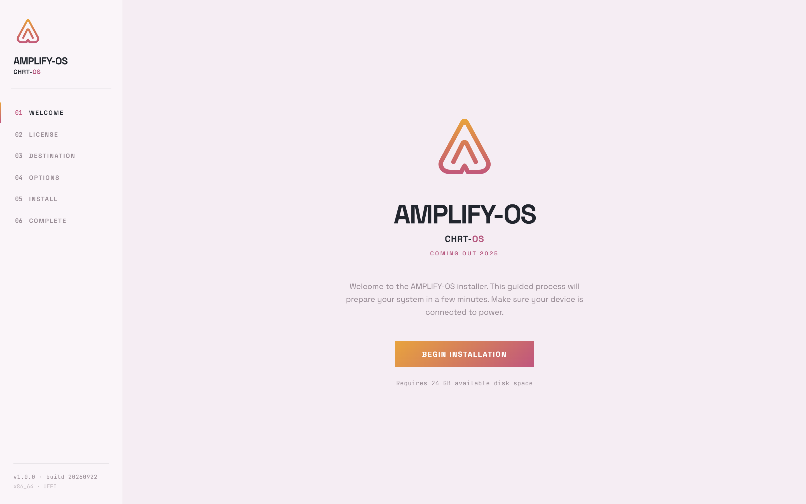

<div align="center">

# AMPLIFY-OS

**Операционная система для x86_64, написанная с нуля. Не Linux.**

C + NASM · без libc и libgcc · GRUB2 Multiboot2 и собственный UEFI-загрузчик

</div>

---

AMPLIFY-OS — самостоятельная операционная система для x86_64 (Long Mode):
ядро на C и ассемблере NASM, собственные драйверы, собственная libc,
графическая подсистема Pearl, сетевой стек с TLS, браузер настоящих сайтов,
шифрование дисков, гипервизор, движок WebAssembly и локальный ИИ-инференс.
Никакой совместимости с Linux по бинарникам — только свой код.

Проект развивается больше трёх лет и прошёл путь от 32-битного прототипа
до системы, которая загружается, рисует интерфейс, ходит в интернет,
шифрует диски, запускает гостевые ОС и отвечает на вопросы локальной
нейросетью. История разработки — в [STORY.md](STORY.md).



## Возможности

### Ядро (x86_64, Long Mode)
- Загрузка: GRUB2 Multiboot2 **или** собственный UEFI-загрузчик (`uefi/`)
- Ядро на C и NASM, **без libc и libgcc** — свои `s_len`/`s_copy`, своя
  арифметика там, где builtins тянут libgcc
- SMP: симметричная многопроцессорность, пул приложенных ядер (AP) для
  параллельных вычислений, планировщик кооперативный на BSP
- Память: PMM, куча, страницы; стек ядра 32 КБ
- Шифрование: FDE по мотивам LUKS1 (AES-256-XTS), совместимость сверяется
  с настоящим libcryptsetup; криптопримитивы через свой `crypto.h`
  (`crypto_wipe`, `crypto_eq_const`, `crypto_rand_bytes`)

### Драйверы и железо
- Диски: virtio-blk (1224 МиБ/с на KVM), SATA AHCI (DMA), IDE/ATA PIO как
  запасной путь; RAM-диск для самотестов
- Графика: virtio-gpu, аппаратный курсор, смена видеорежима
- Ввод: virtio-input (клавиатура, планшет, мышь) и PS/2
- Сеть: virtio-net и e1000, DHCP-автомат с продлением аренды, TCP/IPv4,
  DNS, HTTP/HTTPS

### Графика и интерфейс (Pearl)
- Композитор окон, анимации открытия/закрытия и оверлеев
- Единый визуальный язык «Pearl»: логическая сетка 1600×1000, острые углы,
  градиентные акценты, треугольный логотип
- Терминал Pulse, браузер, сетевые настройки (Mesh), проигрыватель гостей
  (Phantom), консоль WebAssembly (Rune), окно локального ИИ
- Установщик системы с графическим интерфейсом + live-режим

### Сеть и браузер
- TCP/IP без гонок с прерыванием, потоковый HTTP/HTTPS, gzip/deflate, cookies
- TLS 1.2: ECDHE (x25519, P-384), ChaCha20-Poly1305, AES-256-GCM,
  150 корневых сертификатов Mozilla
- Браузер настоящих сайтов (текст и ссылки): ru.wikipedia.org, habr.com,
  github.com и другие открываются живьём; страница 636 КБ — за 33 мс
- Скорость сети: 27–28 МиБ/с по HTTP на virtio-net

### Гипервизор phantom (VT-x)
- Собственный гипервизор на аппаратной виртуализации: VMXON на всех ядрах,
  VMCS, EPT, vCPU-«жилец» на прикладном ядре
- Свой «паравиртуальный» BIOS (INT 10h/13h/15h/16h/1Ah) — загружает
  **неизменённые** ISO: TinyCore CorePure64 и Alpine Linux доходят до
  `login:`
- Цена выхода в хост — 17–18 мкс (~57 тыс. выходов/с); окно гостя в стиле
  Pearl с консолью и библиотекой образов

### WebAssembly (движок rune)
- Свой движок: разбор и валидация модулей, интерпретатор **и** JIT-компилятор
  в машинный код x86-64; WASI preview1
- WebAssembly 2.0 без SIMD; официальный набор тестов принимается целиком:
  1126/1126 верных модулей, 1477/1477 неверных отклонено, 21 453/21 453
  результата исполнения совпадают с эталоном
- Программы на C компилируются clang'ом и работают прямо в ядре ОС на
  отдельном ядре процессора, с лимитами времени/памяти и песочницей файловой
  системы

### AMPLIFY MIND — локальный ИИ
- Собственный GGUF-инференс для семейства llama, написанный в ядре: работает
  SmolLM2-135M и Qwen3-1.7B
- Модель считает пул прикладных ядер (AP), интерфейс не замирает;
  Qwen3 1.8 ГБ грузится с virtio-blk за 5.7 с
- Инструменты ОС доступны модели; вызов по Ctrl+Space из любого места системы

### Системная libc
- Своя реализация libc (`libc-x86_64/`) и POSIX-слой — для собственных
  пользовательских программ
- Крипто-интероп: бинарник, собранный вне ОС, сверяется с libcryptsetup

## Сборка

Требования: WSL Debian (или Linux) с `gcc`, `nasm`, `xorriso`, `mtools`,
`dosfstools`, `gnu-efi`, OVMF.

```bash
make -f Makefile.x86_64 all      # ядро, initrd, установочный ISO, ESP, dev-диск
make -f Makefile.x86_64 run      # запуск в QEMU (откроется окно)
```

Основные цели:

| Цель | Что делает |
|---|---|
| `all` | ядро, initrd, установочный ISO (BIOS+UEFI+USB), `esp.img`, dev-диск |
| `build/kernel-x86_64.bin` | только ядро — быстрая проверка, что собирается |
| `iso` | установочный ISO |
| `bootefi` / `esp` | UEFI-загрузчик и ESP-образ |
| `sysroot` / `libc-test` | libc и её тесты |
| `run-installer` / `run-installed` | установка / запуск установленной системы |

Контроль сборки: `nm build/kernel-x86_64.bin | grep ' U '` должен быть
пустым — неопределённых символов нет (libgcc не подключается).

## Тесты

Каждый этап сопровождается headless-тестом (`scripts/test_stageNN_*.sh`):
QEMU без окна, serial-лог в файл, ввод и скриншоты через монитор/QMP.
Примеры: установщик — 27/27 проверок, шифрование дисков — 25/25, сеть и
браузер — 95/95, гипервизор — 74/74. Регрессия гоняется целиком на узле
с KVM.

## Структура

```
kernel/            всё ядро x86_64 (kernel/kernel64_main.c — точка входа,
                   kernel/arch/x86_64/ — модули: сеть, диски, FDE, GUI,
                   wasm, гипервизор, MIND, libc-слой)
kernel/arch/i386/  наследие: 32-битное поколение (этапы 1–36)
uefi/              собственный UEFI-загрузчик
libc-x86_64/       системная libc
userspace/         пользовательские программы и модули WebAssembly
tools/             хост-утилиты, генераторы шрифтов/таблиц, эталоны
scripts/           headless-тесты QEMU и служебные скрипты
boot/              конфигурация GRUB2
ui_reference/      референсы экранов Pearl
docs/              документация, включая историю первых этапов
```

## Ограничения (честно)

- Браузер — только текст и ссылки: нет картинок, CSS, JavaScript; TLS 1.2
  без TLS 1.3 и HTTP/2; один TCP-сокет на систему
- virtio-gpu только 2D; нет virtio-scsi, NVMe, USB
- IPv6 нет, фрагментация IPv4 не собирается
- Экран гостя в phantom — текстовый 80×25

Полный список ограничений и состояние этапов — в [CLAUDE.md](CLAUDE.md).

## Лицензия

MIT — см. [LICENSE](LICENSE).
